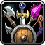

# Player Armory Link

A WoW Forever addon that adds an Armory Link entry to player right-click menus, with the player's armory link ready to copy. Open any player's armory page without typing their name.

## Features

- Armory Link in every player menu: portraits, chat names, friends, guild and community rosters and more.
- A small dialog shows the link already selected.
- One keypress copies it and closes the dialog.
- Works with names in any alphabet.
- Nothing to set up.

## Usage

1. Right-click a player portrait, chat name or roster row.
2. Pick Armory Link.
3. Press Cmd+C on macOS or Ctrl+C on Windows.
4. Paste the link into your browser.

The armory lists characters from level 10.
